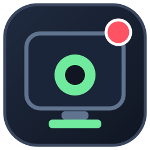

# Rec-lox

**A lightweight, open-source Windows screen recorder for Roblox gameplay.**



## Controls
- **F8** — Start or stop a recording.
- **F9** — Pause or resume.

Rec-lox captures your **primary display** at up to 30 FPS, including the cursor, and saves H.264 MP4 files locally in `Videos\\Rec-lox`. Keep Rec-lox open while playing Roblox.

> **Capture scope:** this first release is video-only. It does not record Roblox/game audio, microphone audio, or system audio. It records the primary monitor rather than an isolated Roblox window.

## Download
Get `Rec-lox-Setup.exe` from the [latest Release](https://github.com/mrcuriousmind3-web/Rec-lox/releases/latest), or use the [Rec-lox website](https://mrcuriousmind3-web.github.io/Rec-lox/).

## Build from source
Requires Windows 10/11, Visual Studio C++ tools, CMake 3.22+, and PowerShell:

```powershell
powershell -ExecutionPolicy Bypass -File tools\\make-icon.ps1
cmake -S . -B build -A x64
cmake --build build --config Release
```

To make an installer, install [Inno Setup 6](https://jrsoftware.org/isinfo.php) and run `iscc installer\\RecLox.iss`.

## Open source
MIT licensed. Contributions and bug reports are welcome. See [CONTRIBUTING.md](CONTRIBUTING.md).

Unofficial community project; not affiliated with or endorsed by Roblox Corporation.
